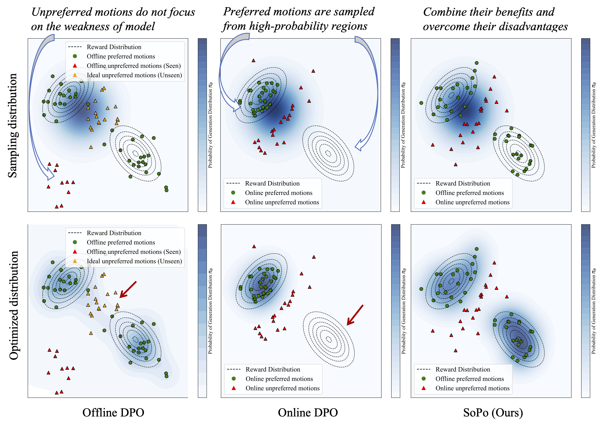

<h1 align="center"><strong>SoPo: Text-to-Motion Generation Using Semi-Online Preference Optimization</strong></h1>
  <p align="center">
   <a href='https://xiaofeng-tan.github.io/' target='_blank'>Xiaofeng Tan<sup>1,2</sup></a>&emsp;
   Hongsong Wang*<sup>1,2</sup>&emsp;
   Xin Geng<sup>1,2</sup>&emsp;
   Pan Zhou<sup>3</sup>&emsp;
    <br>
    <sup>1</sup>Southeast University&emsp;
    <sup>2</sup>PALM Lab @ SEU &emsp;
    <sup>2</sup>Singapore Management University     
    <br>
    *Indicates Corresponding Author
  </p>
</p>

<p align="center">
  <a href="https://neurips.cc/virtual/2025/poster/118773">
    
  </a>
  <a href="https://arxiv.org/abs/2412.05095">
    
  </a>
  <a href="https://xiaofeng-tan.github.io/projects/SoPo/">
    
  </a>
  <a href="https://huggingface.co/ModelsWeights/SoPo">
    
  </a>
</p>

</div>

How effectively can **discriminative** model improve motion **generation** quality *without any inference cost*?

> **TL;DR:** We propose **SoPo**, a *semi-online preference optimization* method, combining the strengths of online and offline direct preference optimization to overcome their individual shortcomings, delivering enhanced motion generation quality and preference alignment.

<div align="center">
    
</div>

## 📣 News
- **[2026/01]** Optimized project structure
- **[2025/11]** We release code for T2M, including evaluation, inference, and training.
- **[2025/09]** SoPo has been officially accepted by *NeurIPS 2025*! 🎉
- **[2024/12]** The paper has been publicly released.

## 📆 Plan
- [x] Release early version.
- [x] Release [final version](https://arxiv.org/abs/2412.05095).
- [x] Release code for T2M: 
  - [x] Release environment guidance.
  - [x] Release evaluation code.
  - [x] Release inference code.
  - [x] Release training code.
  - [x] Release checkpoints.
- [ ] Release code for T2I.
- [ ] Release extended version.

## Models

We provide comprehensive pre-trained models, reward models (TMR), and optimized weights (SoPo) to facilitate reproduction and extension of our work. The following table summarizes the available models and their respective access methods:

| Model Category | Model Name | Description | Access Method | Local Path |
|:---|:---|:---|:---|:---|
| **Diffusion Model** | HumanML-Trans-Dec-512-BERT | Pre-trained motion diffusion model (20× faster inference) | [Google Drive](https://drive.google.com/file/d/1z5IW5Qa9u9UdkckKylkcSXCwIYgLPhIC/view?usp=sharing) | `save/humanml_enc_512_50steps/model000750000.pt` |
| **Reward Model (TMR)** | TMR-HumanML3D | Text-Motion Retrieval model for reward scoring | [Download Script](./prepare/download_tmr.sh) | `./pretrained_tmr/tmr_humanml3d_guoh3dfeats` |
| **Optimized Weights** | SoPo-HumanML3D | SoPo-optimized diffusion weights | [HuggingFace Hub](https://huggingface.co/ModelsWeights/SoPo) | `save/sopo_humanml3d/` |

**Important Note on KIT-ML Compatibility:** Due to the different motion representations employed in the text-to-motion generation and text-motion retrieval tasks for the KIT-ML dataset, the TMR model (for text-motion retrieval tasks) trained on KIT dataset cannot be directly applied to KIT-ML t2m generation fine-tuning. For KIT-ML post-training, we recommend adopting the reward model proposed in [ReAlign](https://github.com/wengwanjiang/ReAlign) for preference optimization.


**Option 1: Automatic Download (Recommended)**

For TMR reward models, use the provided download script:
```bash
bash prepare/download_tmr.sh
```

For SoPo-optimized weights, download from HuggingFace:
```bash
huggingface-cli download ModelsWeights/SoPo --local-dir ./save/sopo_humanml3d/
```

**Option 2: Manual Download**

- **Diffusion Model**: Download from [Google Drive](https://drive.google.com/file/d/1z5IW5Qa9u9UdkckKylkcSXCwIYgLPhIC/view?usp=sharing), then extract to `save/humanml_enc_512_50steps/`
- **TMR Models**: Execute `bash prepare/download_tmr.sh` to fetch both HumanML3D and KIT-ML variants
- **SoPo Weights**: Access via [HuggingFace Hub](https://huggingface.co/ModelsWeights/SoPo) for the latest optimized checkpoints


## Project Structure

After completing the setup, your project directory should look like this:

```
motion-diffusion-model/
├── assets/                     # Static assets and example files
├── body_models/               # SMPL body model files
├── configs/                   # Configuration files
├── data_loaders/             # Data loading utilities
├── dataset/                  # Dataset directory
│   ├── HumanML3D/           # HumanML3D dataset
│   │   ├── annotations_humanml3d/  # Text annotations
│   │   └── motions_guoh3dfeats/    # Motion features
│   └── KIT-ML/              # KIT-ML dataset
├── diffusion/               # Diffusion model implementation
├── eval/                    # Evaluation scripts
├── glove/                   # GloVe embeddings
├── model/                   # Model definitions and checkpoints
│   ├── cfg_sampler.py      # Configuration sampler
│   ├── mdm.py              # Main diffusion model
│   ├── rotation2xyz.py     # Rotation utilities
│   ├── smpl.py             # SMPL model interface
│   └── models/             # Pre-trained model files
├── outputs/                 # Generated outputs
├── prepare/                 # Setup and download scripts
├── pretrained_tmr/         # TMR reward models
│   └── tmr_humanml3d_guoh3dfeats/
├── sample/                  # Sampling and generation scripts
├── save/                    # Training checkpoints and results
│   ├── humanml_enc_512_50steps/  # Pre-trained diffusion model
│   └── sopo_humanml3d/          # SoPo-optimized weights
├── src_tmr/                # TMR source code
├── stats/                   # Statistical data
├── train/                   # Training scripts
├── utils/                   # Utility functions
├── visualize/              # Visualization tools
├── sopo_environment.yml    # Conda environment file
└── README.md               # This file
```

**Key Directories:**
- `dataset/`: Contains all training and evaluation datasets
- `model/`: Unified model definitions and checkpoints (merged from previous `models/`)
- `save/`: Training outputs and model checkpoints
- `pretrained_tmr/`: TMR reward models for preference optimization
- `sample/`: Scripts for motion generation and sampling

## Setup

### 1. Setup environment

Install ffmpeg (if not already installed):

```shell
sudo apt update
sudo apt install ffmpeg
```

Setup conda env:
```shell
conda env create -f sopo_environment.yml
conda activate sopo
python -m spacy download en_core_web_sm
pip install git+https://github.com/openai/CLIP.git
```

Download dependencies:

```bash
bash prepare/download_smpl_files.sh
bash prepare/download_glove.sh
bash prepare/download_t2m_evaluators.sh
```

### 2. Get data

**HumanML3D** - Follow the instructions in [HumanML3D](https://github.com/EricGuo5513/HumanML3D.git),
then copy the result dataset to our repository:

```bash
# After processing HumanML3D, copy to our dataset directory
cp -r /path/to/HumanML3D ./dataset/
```

The HumanML3D dataset should be placed in `./dataset/HumanML3D/` with the following structure:
- `annotations_humanml3d/`: Text annotations and metadata
- `motions_guoh3dfeats/`: Processed motion features

**KIT-ML** - Download from [Here](https://github.com/EricGuo5513/HumanML3D.git) (no processing needed this time) and place the result in `./dataset/KIT-ML`

**Note:** The dataset directory has been reorganized for better structure. All datasets are now centralized under `./dataset/` directory.

### 3. Download the pretrained models

Use the model download instructions provided in the **Models** section above.

### 4. Verify TMR Setup

To verify that the TMR reward model is correctly set up, run:

```bash
python text_motion_sim.py
```

## Quick Start

### Training

To train the SoPo model, use the following command:

```bash
python -m train.train_sopo --save_dir save/sopo_experiment --dataset humanml
```

For more training options and configurations, see the training scripts in `train/`.

### Inference

#### Generate from test set prompts

Generate multiple motions from the test set prompts:

```shell
python -m sample.generate --model_path ./save/humanml_trans_enc_512/model000200000.pt --num_samples 10 --num_repetitions 3
```

#### Generate from text file

Generate motions from a file containing multiple text prompts:

```shell
python -m sample.generate --model_path ./save/humanml_trans_enc_512/model000200000.pt --input_text ./assets/example_text_prompts.txt
```

#### Generate from a single text prompt

Generate motion from a single custom text description:

```shell
python -m sample.generate --model_path ./save/humanml_trans_enc_512/model000200000.pt --text_prompt "the person walked forward and is picking up his toolbox."
```

### Evaluation

To evaluate the model on standard benchmarks, run:

```shell
python -m eval.eval_humanml --model_path ./save/humanml_trans_enc_512/model000475000.pt
```

### Visualization

For motion visualization and rendering, please refer to the official [MotionLCM](https://github.com/Dai-Wenxun/MotionLCM) repository for detailed instructions.

## Acknowledgement

This work is built on many amazing research works and open-source projects, thanks a lot to all the authors for sharing!

- https://github.com/GuyTevet/motion-diffusion-model
- https://github.com/ChenFengYe/motion-latent-diffusion
- https://github.com/Dai-Wenxun/MotionLCM

## Citation
If you find this repository/work helpful in your research, please consider citing the paper and starring the repo ⭐.

```
@article{tan2025sopo,
  title={SoPo: Text-to-Motion Generation Using Semi-Online Preference Optimization},
  author={Tan, Xiaofeng and Wang, Hongsong and Geng, Xin and Zhou, Pan},
  conference={Advances in Neural Information Processing Systems},
  year={2025}
}
```
